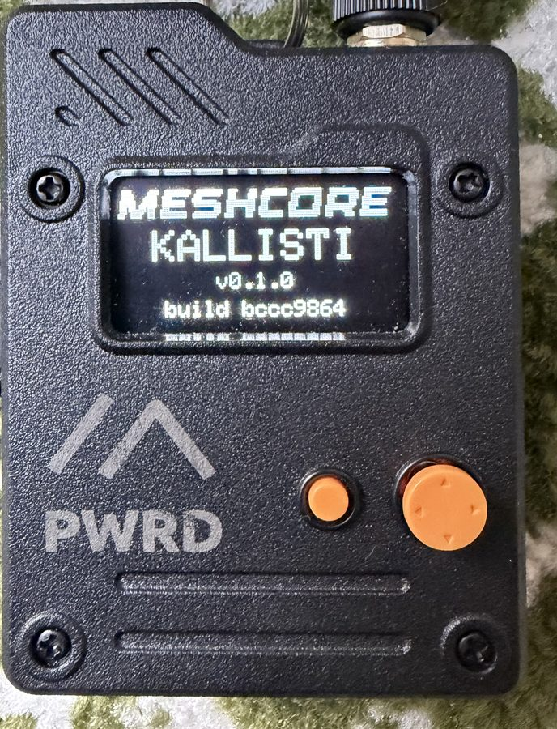

<h1 align="center">🍏 KALLISTI</h1>

MeshCore companion firmware for the **Seeed Wio Tracker L1 Pro** that works without a phone.
Read, reply and share your position from the device itself, using the joystick and OLED.

> Unofficial fork of [meshcore-dev/MeshCore](https://github.com/meshcore-dev/MeshCore), based on `companion-v1.17.1`.
> Radio, routing, encryption and the phone protocol are unchanged, so it works with MeshCore apps and networks.

<p align="center">
  
</p>

## Features

- **Inbox.** 64 saved messages that survive restarts, with unread markers and delete/clear.
- **Channel messages.** Kept in RAM unless you save them. Optional auto-read when idle.
- **Replies and Quick send.** Presets (OK, YES, NO, THANKS, NEED HELP, …) or custom text typed with the joystick. Drafts are kept.
- **Position sharing.** Send your saved position or a GPS fix no older than 30 seconds. Stale fixes are refused.
- **Outbox.** The last 16 sends with ACK status and manual retry.
- **GPS page.** Fix status, satellites, coordinates, altitude and fix age.
- **Actions page.** Bluetooth, advert, hibernate, channels, buzzer, auto-read, clock and storage cleanup.

Nothing is sent without a confirmation screen showing the recipient and the exact text.

## Install

1. Download the `.uf2` from [Releases](https://github.com/gdamdam/kallisti-meshcore-wio-l1pro/releases).
2. Back up your identity, contacts and channels with the MeshCore app.
3. Connect USB and double-press Reset. A drive appears.
4. Copy the `.uf2` onto it and wait for the reboot.

**Going back:** flash the official MeshCore v1.17.1 Wio BLE UF2 the same way. Identity and settings are kept. The local inbox is not, because official firmware can't read its format.

## Controls

| Button | Action |
|---|---|
| Left / Right | Switch page: Messages, Adverts, Radio, Quick send, Outbox, GPS, Actions |
| Center | Open, select, confirm |
| Up / Down | Scroll |
| Right (in a message) | Message actions and reply |
| Menu | Back |
| Menu, double-click | Buzzer on/off |

The phone app still connects over Bluetooth as usual. The default PIN is `123456`.

Full reference: [UI and controls](docs/wio-ui.md) · [Inbox, replies and storage](docs/wio-inbox.md)

## Build

Requires [PlatformIO](https://docs.platformio.org).

```sh
FIRMWARE_VERSION=v0.1.0 bash build.sh build-firmware WioTrackerL1_companion_radio_ble
```

The UF2 is written to `out/`. Only this target is maintained. Other boards in `variants/` are upstream MeshCore, untouched.

Host tests:

```sh
python3 test/test_recent_messages/run_tests.py
python3 test/test_recent_messages/run_gps_tests.py   # needs one build first, for the GPS library
```

Release process and upstream tracking: [RELEASE.md](RELEASE.md).

## Credits and license

Built on [MeshCore](https://github.com/meshcore-dev/MeshCore) by Scott Powell / rippleradios.com and contributors. Report issues with this firmware here, not upstream.

MIT, same as MeshCore. See [license.txt](license.txt).
